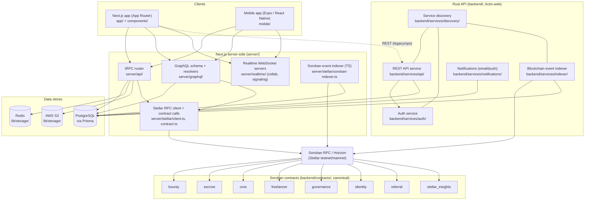

# Architecture overview (issue #1629)

This is a map of the whole platform for someone new to the repo: the
Next.js app, its API surfaces (tRPC/GraphQL/REST), the Rust backend
services, the Soroban contracts, the mobile app, and where each piece's
data lives. It intentionally stays one level deep — see
[`README.md#project-structure`](../README.md#project-structure) and
[`backend/README.md`](../backend/README.md#architecture) for the
file-level breakdown of each box below.

## Whole-platform diagram

## What each box is for

- **Next.js app** (`app/`, `components/`) — the web client. Pages and API
  routes only; everything that isn't rendering lives under `server/` or
  `lib/`.
- **Mobile app** (`mobile/`) — Expo/React Native, its own toolchain and
  package.json, talks to the same tRPC/GraphQL/realtime surfaces as the
  web app.
- **tRPC router** (`server/api/`) — the primary typed API surface for the
  Next.js app and mobile.
- **GraphQL** (`server/graphql/`) — a second query surface over mostly the
  same domain data; see its own `resolvers.ts`/`schema.ts` for exactly
  what it covers (follow the [GraphQL security best practices](https://graphql.org/learn/security/)
  linked from issue #1629 if you're extending this surface — this
  codebase has had real query-depth/complexity issues here before).
- **Realtime servers** (`server/realtime/`) — standalone WebSocket
  servers for collaboration (`collab.ts`) and WebRTC signaling
  (`signaling.ts`), separate from the HTTP request/response path.
- **Stellar RPC client / Soroban indexer (TS)** (`server/stellar/`) — the
  Next.js side's own path to Soroban RPC, independent of the Rust
  indexer below; see [Soroban RPC `getEvents`](https://developers.stellar.org/docs/data/apis/rpc/api-reference/methods/getEvents)
  for how both indexers actually pull contract events.
- **Rust API / Auth / Indexer / Discovery / Notifications**
  (`backend/services/*`) — a separate Actix-web service tier. `discovery`
  lets the other services find each other; `indexer` is a second,
  independent path from contract events to Postgres (the TypeScript one
  above is the other). Don't assume these are redundant with the
  Next.js-side equivalents without checking which one a given feature
  actually reads from — they are not interchangeable today.
- **Soroban contracts** (`backend/contracts/`) — canonical on-chain logic.
  The top-level `contracts/` directory (not pictured here) is legacy/
  scaffold and not built by CI — see the note in the root
  [README's Project Structure section](../README.md#project-structure)
  before touching it.
- **Data stores** — Postgres (Prisma) is the system of record; Redis and
  S3 are used from `lib/storage/` for caching/rate-limiting and object
  storage respectively. Both the TS and Rust indexers write Soroban
  contract events into the same Postgres instance.

## Scope note

This stays one level deep by design — a diagram with every file would
defeat the purpose of shortening onboarding. For the next level down in
any box, follow the path mentioned in that box out to the file-level
breakdown in `README.md` or `backend/README.md`.
