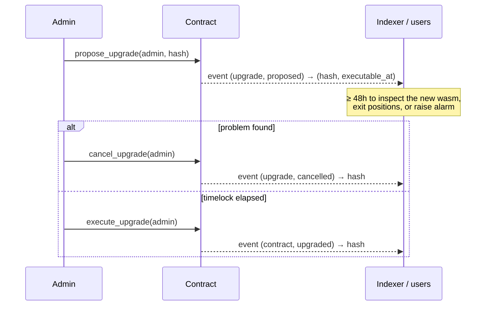

# Soroban contract deploy & upgrade process

How CI deploys the Soroban smart contracts in `backend/contracts/*`, where
the resulting contract addresses go, and how to upgrade a contract that is
already live without breaking its callers.

## Networks

| Network | Workflow | Trigger | Approval |
|---|---|---|---|
| Testnet | [`deploy-contracts.yml`](../.github/workflows/deploy-contracts.yml) | Every push to `main` | None — automatic |
| Mainnet | [`deploy-mainnet.yml`](../.github/workflows/deploy-mainnet.yml) | A GitHub **release** being published (not drafts, not pre-releases) | Manual: the `mainnet` GitHub Environment requires reviewer approval before the job runs |

Merging to `main` only ever reaches Testnet. Mainnet always requires a
deliberate release (see "Promoting to Mainnet" below) — this is enforced by
the workflow trigger itself (`on: release: types: [published]`), not just by
convention.

```mermaid
flowchart LR
    PR[PR merged to main] --> TN[deploy-contracts.yml\nTestnet, automatic]
    TN --> QA[Manual QA on Testnet]
    QA --> REL[Tag + publish a GitHub release\nvX.Y.Z]
    REL --> VAL[validate-release\nsemver tag, not a pre-release]
    VAL --> SIM[simulate-contracts\nsimulate against 2 RPC endpoints]
    SIM --> APPROVAL{{mainnet environment\nreviewer approval}}
    APPROVAL --> DEPLOY[deploy-contracts job\nnode scripts/deploy.js]
    DEPLOY --> FE[deploy-frontend\nVercel production, contract IDs baked in]
```

## What each pipeline does

### Testnet (`deploy-contracts.yml`)

1. `test` — `cargo test --workspace --all-features` against the `backend`
   workspace.
2. `build` — installs `stellar-cli`, builds the bounty / escrow /
   freelancer / governance / oracle / identity contract packages for
   `wasm32-unknown-unknown` (not `wasm32v1-none`; see the comment in the
   workflow — the contracts in this workspace aren't `std`-less), then runs
   `stellar contract optimize` on each `.wasm` and uploads them as a build
   artifact (`contract-wasm-${{ github.sha }}`).
3. `deploy-testnet` — downloads that artifact and runs
   [`scripts/deploy.js`](../scripts/deploy.js) against
   `https://soroban-testnet.stellar.org` using the `TESTNET_DEPLOYER_SECRET`
   repository secret, then writes `contracts.json` (network, commit SHA,
   timestamp, and each contract's deployed ID) and uploads it as its own
   artifact (`contracts-testnet-${{ github.sha }}`).
4. `notify` — posts success/failure to Slack (if `SLACK_WEBHOOK_URL` is
   set) and writes a `$GITHUB_STEP_SUMMARY`.

### Mainnet (`deploy-mainnet.yml`)

1. `validate-release` — rejects the run unless `GITHUB_REF_NAME` is a plain
   semver tag (`vX.Y.Z`) with no pre-release suffix (`v1.0.0-rc.1` is
   rejected). This is the only gate that stands between a release and a
   mainnet deploy, so it fails closed.
2. `simulate-contracts` — rebuilds the same packages, reruns the unit
   tests, then runs `node scripts/deploy.js --simulate-only` against the
   primary Mainnet RPC (blocking) and again against a secondary RPC
   provider for cross-validation (warning-only, so a degraded secondary
   doesn't block a release).
3. `deploy-contracts` — gated on the `mainnet` GitHub Environment (configure
   required reviewers there — this is what makes the deploy "manual
   approval" in practice). Runs `node scripts/deploy.js` for real against
   Mainnet with `MAINNET_DEPLOYER_SECRET`, and exposes each contract ID as a
   job output.
4. `deploy-frontend` — builds the Next.js app with
   `NEXT_PUBLIC_{BOUNTY,ESCROW,FREELANCER,GOVERNANCE,ORACLE,IDENTITY}_CONTRACT_ID`
   set from the previous job's outputs, then deploys to Vercel production.
5. `notify` — Slack + Discord with every contract ID, plus a step summary.

## Where contract addresses go

There is no single "contracts registry" file in the repo — addresses are
produced per deploy and consumed by whichever layer needs them:

- **Testnet**: written to `contracts.json` and uploaded as the
  `contracts-testnet-${{ github.sha }}` build artifact. There's no automatic
  publish step beyond that artifact today; if you need the Testnet IDs
  outside of CI, download that artifact from the workflow run (see
  `docs/contracts.md#promoting-to-mainnet` for the equivalent idea applied to
  Mainnet).
- **Mainnet**: emitted as `deploy-contracts` job outputs
  (`bounty_contract_id`, `escrow_contract_id`, `freelancer_contract_id`,
  `governance_contract_id`, `oracle_contract_id`, `identity_contract_id`),
  which `deploy-frontend` reads directly and bakes into the Next.js build as
  `NEXT_PUBLIC_*_CONTRACT_ID`. They are also broadcast to Slack/Discord and
  the GitHub Actions run summary for a human-readable record of what's live.
- **Local dev**: `.env.local` (see `.env.example`) — there is no automated
  sync from a deploy back into `.env.example`; update it by hand after a
  Mainnet/Testnet address changes if local tooling needs to point at it.

## Promoting to Mainnet

1. Confirm the commit has been live on Testnet and manually exercised.
2. Tag it and publish a GitHub release with a plain semver tag, e.g. `v1.4.0`
   — publishing a **draft** or a **pre-release** tag will not trigger
   `deploy-mainnet.yml` at all (draft) or will be rejected by
   `validate-release` (pre-release suffix).
3. The `mainnet` GitHub Environment will block `deploy-contracts` until a
   configured reviewer approves the run — approve it from the Actions tab
   once you've checked `simulate-contracts` passed cleanly.
4. After `deploy-frontend` finishes, confirm the new contract IDs in the
   Slack/Discord notification (or the run's `$GITHUB_STEP_SUMMARY`) match
   what you expect before telling anyone the release is out.

## Upgrading a contract that is already live

Upgrades are **timelocked**, and the admin role moves in **two steps**
(Issue #1564). The shared logic lives in
[`backend/contracts/upgradeable`](../backend/contracts/upgradeable/src/lib.rs)
(crate `stellar-upgradeable`). Every contract with an admin calls into it:
bounty, escrow, freelancer, governance, oracle, identity, stellar_insights,
core, referral and insurance.

### Why

Before this change, each contract had an `upgrade(admin, new_wasm_hash)`
entrypoint that swapped the code **in the same transaction**. Anyone holding
the admin key, including an attacker who had stolen it, could replace a
contract's logic (for example to drain escrowed funds) with no warning to
users. The admin role also couldn't be rotated safely. It was either fixed
forever or set once through `set_admin`, with nothing to stop a typo from
handing it to an address no one controls.

### Entrypoints (same on every contract)

| Entrypoint | Who signs | Effect |
|---|---|---|
| `propose_upgrade(admin, new_wasm_hash) -> u64` | admin | Records the pending upgrade and returns `executable_at` (now + 48h). A new proposal replaces the old one and restarts the clock. |
| `execute_upgrade(admin)` | admin | Swaps in the pending wasm if `now >= executable_at`. |
| `cancel_upgrade(admin)` | admin | Drops the pending upgrade. |
| `get_pending_upgrade() -> Option<PendingUpgrade>` | — | `{ wasm_hash, proposed_at, executable_at }` |
| `propose_admin(admin, new_admin)` | admin | Nominates a successor. Nothing changes yet. |
| `accept_admin(new_admin)` | **nominee** | Completes the transfer, so the nominee must prove they control the key. |
| `cancel_admin_transfer(admin)` | admin | Drops the nomination. |
| `get_pending_admin() -> Option<Address>` | — | The current nominee, if any. |

The instant `upgrade` entrypoint has been **removed**. The timelock is the
constant `UPGRADE_TIMELOCK_SECS` (48 hours) on every network.

### Events

| Topics | Data |
|---|---|
| `(upgrade, proposed)` | `(wasm_hash: BytesN<32>, executable_at: u64)` |
| `(upgrade, cancelled)` | `wasm_hash` |
| `(contract, upgraded)` | `wasm_hash`. Same shape as the old instant upgrade, so existing indexer mappings still work. |
| `(admin, proposed)` | `(current_admin, nominee)` |
| `(admin, accepted)` | `(previous_admin, new_admin)` |
| `(admin, cancelled)` | `nominee` |

Indexers and monitoring should alert on `(upgrade, proposed)`. That event is
users' advance notice of a code change. Read events with Soroban RPC
[`getEvents`](https://developers.stellar.org/docs/data/apis/rpc/api-reference/methods/getEvents).

### Errors

These surface as `Error(Contract, #n)`. The codes start at 900 so they never
overlap a contract's own error enum.

| Code | Variant | Meaning |
|---|---|---|
| 900 | `Unauthorized` | Caller is not the stored admin |
| 901 | `NoPendingUpgrade` | `execute_upgrade` or `cancel_upgrade` was called with nothing pending |
| 902 | `TimelockNotElapsed` | `execute_upgrade` was called before `executable_at` |
| 903 | `NoPendingAdmin` | `accept_admin` or `cancel_admin_transfer` was called with no nominee |
| 904 | `NotPendingAdmin` | `accept_admin` was signed by someone other than the nominee |
| 905 | `SameAdmin` | `propose_admin` nominated the current admin |

### Procedure

1. Build and optimize the new `.wasm` the same way CI does (`cargo build
   --release --target wasm32-unknown-unknown`, then `stellar contract
   optimize`) so the deployed bytecode matches what was reviewed.
2. Upload it to get its hash:
   `stellar contract upload --wasm <path> --source <admin-identity> --network <network>`.
3. Call `propose_upgrade(admin, new_wasm_hash)`. Publish the hash and the
   returned `executable_at` (release notes, Slack/Discord) so anyone can diff
   the bytecode during the window.
4. After `executable_at`, call `execute_upgrade(admin)`. Watch for
   `(contract, upgraded)` and smoke-test a read and a write entrypoint.
5. Record the new wasm hash wherever `contracts.json` or the deploy
   notification would otherwise be stale. The contract ID does not change.

The upgrade does not touch persistent storage, so any change to the storage
shape must be handled by the new code reading old-shape data. Soroban does
not migrate storage for you.

To rotate the admin, call `propose_admin(admin, new_admin)`, then have
`new_admin` sign `accept_admin(new_admin)`. Each contract writes the accepted
address to its own admin slot: `bounty_admin`, `platform_admin` (escrow),
`owner` (freelancer), `GovernanceConfig.admin_address`, or `DataKey::Admin` /
`admin` elsewhere.

### Deferred

- The 48h delay is the same on Testnet and Mainnet. A per-network or
  governance-set delay would need its own timelock so it can't be shortened
  instantly.
- One-shot bootstrap setters (`set_admin` on bounty and escrow) are unchanged.
  They only work while no admin is set.
