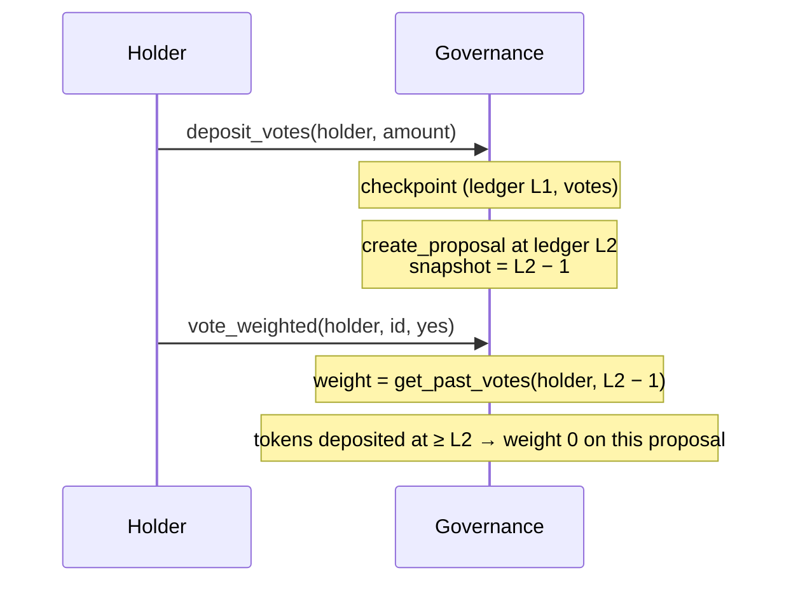

# Governance voting power and snapshots

How the governance contract
([`backend/contracts/governance/src/lib.rs`](../backend/contracts/governance/src/lib.rs))
weighs token votes (Issue #1565).

## Threat

`vote_weighted(voter, proposal_id, vote_yes, token_weight)` used to accept
the vote weight **from the caller**. Anyone could claim any weight. Even if
the weight had been read from a live balance, an attacker could borrow or buy
tokens, vote, and give them back, or pass the same tokens between accounts and
vote with each one.

## Design

Voting power comes from governance tokens **deposited** into the contract.
Each change to a depositor's balance writes a checkpoint
`VotingCheckpoint { ledger, votes }`. Each proposal records a **snapshot
ledger** when it is created, and votes are weighed by the voter's power at
that ledger.

- The snapshot is `creation_ledger - 1`, so a deposit in the same ledger as
  the proposal (for example, bundled with a borrow) does not count.
- Withdrawing after voting does not change votes already cast. Withdrawn
  tokens that are re-deposited from another account have no power on any
  proposal whose snapshot is earlier than the new deposit.
- Proposals created before this change have no snapshot, so `vote_weighted`
  rejects them (`Proposal has no voting snapshot`).
- The one-address-one-vote `vote` entrypoint is unchanged.

## Entrypoints

| Entrypoint | Who signs | Notes |
|---|---|---|
| `set_voting_token(admin, token)` | admin | Can be set only once. Changing the token would invalidate existing checkpoints. |
| `get_voting_token() -> Option<Address>` | — | |
| `deposit_votes(account, amount) -> i128` | account | Transfers tokens into the contract and returns the new power |
| `withdraw_votes(account, amount) -> i128` | account | Returns tokens and the remaining power |
| `get_votes(account) -> i128` | — | Current power |
| `get_past_votes(account, ledger) -> i128` | — | Power at the end of `ledger` |
| `get_proposal_snapshot(proposal_id) -> u32` | — | Snapshot ledger |
| `vote_weighted(voter, proposal_id, vote_yes)` | voter | **Breaking:** the `token_weight` argument is removed |

## Events

| Topics | Data |
|---|---|
| `(gov, snapshot)` | `(proposal_id, snapshot_ledger)`, emitted right after `(gov, created)` |
| `(gov, vp_token)` | `(token,)` |
| `(gov, vp_dep)` | `(account, amount, new_votes)` |
| `(gov, vp_wd)` | `(account, amount, new_votes)` |
| `(gov, wvoted)` | `(proposal_id, voter, vote_yes, weight)`, unchanged shape. `weight` now comes from the snapshot. |

Failure messages: `Voting token not set`, `Voting token already set`,
`Amount must be positive`, `Insufficient voting power`,
`Proposal has no voting snapshot`, `No voting power at snapshot`,
`Voting power overflow`.

## Deferred

- Quorum still uses the admin-set `total_voting_power`. It is not a snapshot
  of total deposits.
- Checkpoint entries get a 30-day TTL bump on every write. A long-idle
  account's old checkpoints may need restoring before `get_past_votes` can
  read them.
