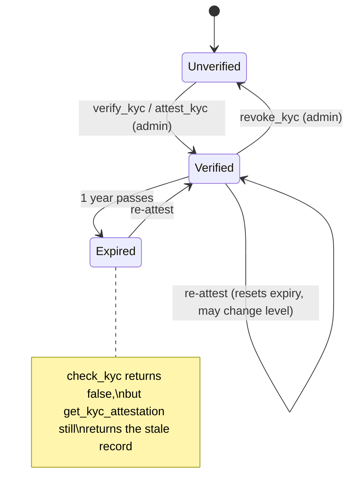

# Identity contract: what "verified" means

This page defines the attestations stored by the Soroban identity contract
([`backend/contracts/identity/src/lib.rs`](../backend/contracts/identity/src/lib.rs)).
It covers who can issue each one, when they expire, how they are revoked, and
how the app should read them. Read it before you derive a trust badge from
on-chain data (Issue #1567).

If you are new to Soroban, start with the
[Soroban smart contract docs](https://developers.stellar.org/docs/build/smart-contracts/overview).
An *attestation* here is a record in contract storage that says "the issuer
vouches that this address has property X". Anyone can read it. Only the
named issuer can write or remove it.

## Three independent attestations

Each attestation answers a different question, and none of them implies the
others.

| Attestation | Answers | Issued by | Levels | Expiry | Revoked by |
|---|---|---|---|---|---|
| **Social proof** | Does this address control social handle *H*? | The address itself, with an Ed25519 signature over `domain_hash` | Present or absent | None | The owner (`revoke_proof`) |
| **KYC attestation** | Did the platform check this person's identity documents? | Platform admin | `Basic` (0) < `Enhanced` (1) < `Institutional` (2) | 1 year after issue | Platform admin (`revoke_kyc`) |
| **Verification tier** | What trust tier has the platform assigned this creator? | Platform admin | `None`, `Verified`, `Trusted`, `Elite` | None | Platform admin (`revoke_tier`) |

"Platform admin" is the address stored by `initialize`. It can be rotated
with the two-step `propose_admin` / `accept_admin` flow (see
[contracts.md](./contracts.md#upgrading-a-contract-that-is-already-live)).

### Social proofs

- `submit_proof(owner, domain_hash, public_key, proof)`: `owner` signs the
  transaction, and the contract checks the Ed25519 signature `proof` over
  `domain_hash` under `public_key` (`env.crypto().ed25519_verify`). If the
  signature is bad, the call fails.
- The contract does **not** check that `public_key` belongs to the social
  account. The off-chain flow that produced `domain_hash` must establish that
  link. A social proof on its own means only that the owner holds a key that
  signed this hash.
- `has_proof(owner, domain_hash)` returns `true` while the proof exists.
  `proof_count(owner)` counts live proofs.

### KYC attestations

- `verify_kyc(admin, user, kyc_submission_id)` is what the app calls today
  (through [`server/services/identity-contract.ts`](../server/services/identity-contract.ts))
  after an admin approves a `KYCSubmission`. It always writes level `Basic`.
  The event carries the hashed submission ID so the on-chain record can be
  traced back to the off-chain review.
- `attest_kyc(admin, user, level)` writes an arbitrary level.
- Both calls **overwrite** any existing attestation and reset the one-year
  expiry. Re-issuing at a lower level downgrades the user.
- `check_kyc(user, required_level)` is the canonical read. It returns `true`
  only if an attestation exists, it has not expired (`now <= expires_at`),
  and its level is at least `required_level`.

### Verification tiers

- `set_tier(attester, owner, tier)`: the attester **must be the platform
  admin**. Before Issue #1567, any address could sign this for any owner,
  so tiers were self-issuable and must not be trusted. Ignore `tier_set`
  events that are earlier than this fix.
- `get_tier(owner)` returns the tier, or `None` if none was set or it was
  revoked.
- Tiers do not expire. Downgrade a tier with `set_tier`, or remove it with
  `revoke_tier`.

## Revocation

Revoking an attestation **deletes** it. After `revoke_kyc`, `check_kyc`
returns `false` at every level and `get_kyc_attestation` returns `None`, so a
revoked user reads exactly like one who was never verified. There is no
"revoked" flag to check and no way to tell the two cases apart on-chain. Use
the `(kyc, revoked)` event if you need the history. `revoke_tier` and
`revoke_proof` work the same way.

From the server, call `revokeKycOnChain(userAddress)` in
`server/services/identity-contract.ts`.

## How to read attestations for a badge

- **KYC badge:** use `check_kyc(user, level)`. Do **not** read
  `get_kyc_attestation` and display it without checking `expires_at`, because
  it still returns expired records.
- **Tier badge:** use `get_tier(owner)` and treat `None` as no badge.
- **Social badge:** use `has_proof(owner, domain_hash)`.
- Never combine these attestations: a high tier does not mean KYC passed, and
  passing KYC does not grant a tier.

## Events

These events can be read with Soroban RPC
[`getEvents`](https://developers.stellar.org/docs/data/apis/rpc/api-reference/methods/getEvents).

| Topics | Data | Emitted by |
|---|---|---|
| `(identity, proof_ok)` | `(owner, domain_hash)` | `submit_proof` |
| `(identity, revoked)` | `(owner, domain_hash)` | `revoke_proof` |
| `(kyc, attested)` | `(user, level)` | `attest_kyc` |
| `(kyc, verified)` | `(user, kyc_submission_id)` | `verify_kyc` |
| `(kyc, revoked)` | `(user, revoked_level)` | `revoke_kyc` |
| `(identity, tier_set)` | `(owner, tier)` | `set_tier` |
| `(identity, tier_rev)` | `(owner, revoked_tier)` | `revoke_tier` |

## Failure messages

Most entrypoints panic with a string message rather than a typed error:

| Message | Cause |
|---|---|
| `Not initialized` | `initialize` has not been called |
| `Only admin can attest KYC` / `verify KYC` / `revoke KYC` / `set tier` / `revoke tier` | Caller is not the stored admin |
| `KYC attestation not found` | `revoke_kyc` was called for a user with no attestation |
| `Tier not set` | `revoke_tier` was called for an owner with no tier |
| `Proof already verified` / `Proof not found` | Social proof already exists, or is missing |

## Deferred

- KYC expiry is fixed at one year. Per-level or configurable expiry is not
  implemented.
- Tier attestations have no expiry.
- There is no on-chain allow-list of multiple issuers. Every issuer-gated call
  uses the single platform admin.
